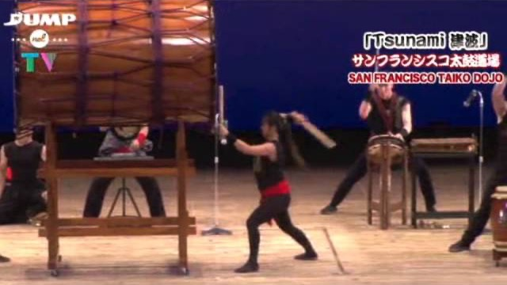
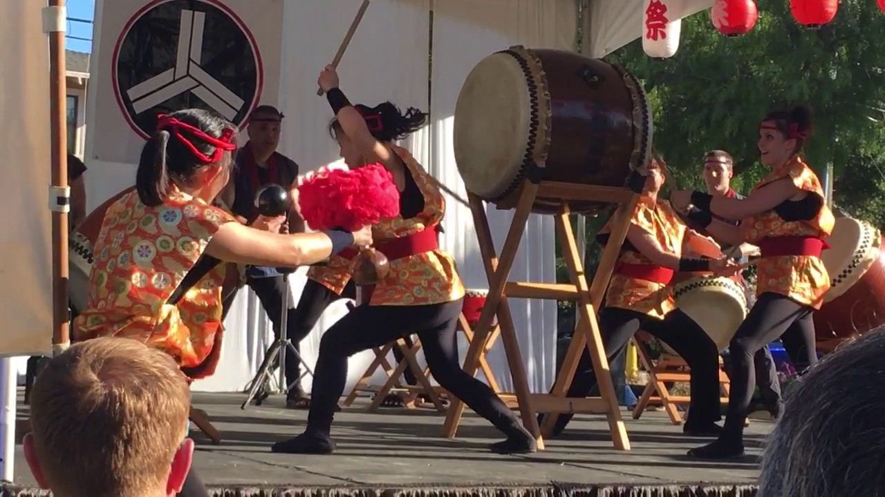
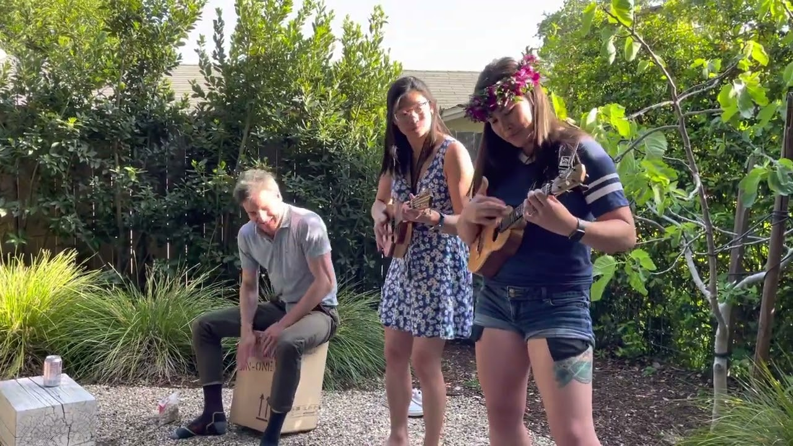
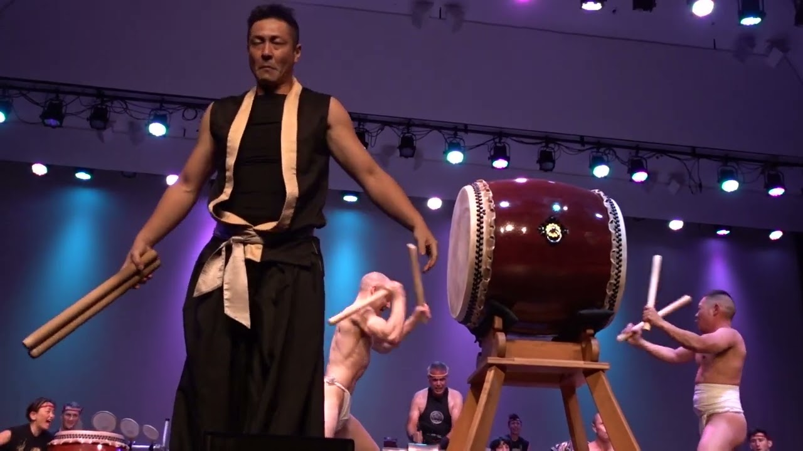

### Hi, I'm Benji!

## Games
<ul class="games">
  <li><a href="https://wordbreak.games">WWordBreak</a></li>
  <li><a href="https://benpastel.com/changeling">🀙Changeling</a></li>
  <li><a href="https://benpastel.com/junkyard"><svg viewBox="-26 -1 152 152" aria-hidden="true"><rect width="100" height="100" fill="#3b3f46"/><rect x="2" y="2" width="96" height="96" fill="none" stroke="#24272c" stroke-width="4"/><g fill="#7a756c"><circle cx="13" cy="13" r="3.5"/><circle cx="87" cy="13" r="3.5"/><circle cx="13" cy="87" r="3.5"/><circle cx="87" cy="87" r="3.5"/></g><rect x="20" y="30" width="60" height="55" fill="#1c1e22"/><circle cx="50" cy="42" r="16" fill="#555b63"/><path d="M32 80H68L90 118L10 115Z" fill="#7d838b"/><path d="M38 86H62L78 113L22 112Z" fill="#2a2d33"/><rect x="20" y="62" width="60" height="8" fill="#b9b29a"/><path d="M18 117L50 152L82 117Z" fill="#ff8a2a"/><path d="M34 117L50 136L66 117Z" fill="#ffe08a"/></svg>Junkyard Armada</a></li>
  <li><a href="https://boilerplate.games"><svg viewBox="0 0 64 64" aria-hidden="true"><defs><radialGradient id="bpBrass" cx="0.35" cy="0.32" r="0.75"><stop offset="0" stop-color="#FFF6D2"/><stop offset="0.4" stop-color="#F5C44A"/><stop offset="1" stop-color="#9A6414"/></radialGradient></defs><g transform="translate(44 44) scale(1.2) rotate(10)"><path d="M12.2 -2.7 L16.4 -1.9 L16.4 1.9 L12.2 2.7 L11.4 5.0 L14.4 8.1 L12.2 11.1 L8.3 9.3 L6.3 10.8 L6.8 15.0 L3.3 16.2 L1.3 12.4 L-1.3 12.4 L-3.3 16.2 L-6.8 15.0 L-6.3 10.8 L-8.3 9.3 L-12.2 11.1 L-14.4 8.1 L-11.4 5.0 L-12.2 2.7 L-16.4 1.9 L-16.4 -1.9 L-12.2 -2.7 L-11.4 -5.0 L-14.4 -8.1 L-12.2 -11.1 L-8.3 -9.3 L-6.3 -10.8 L-6.8 -15.0 L-3.3 -16.2 L-1.3 -12.4 L1.3 -12.4 L3.3 -16.2 L6.8 -15.0 L6.3 -10.8 L8.3 -9.3 L12.2 -11.1 L14.4 -8.1 L11.4 -5.0Z" fill="url(#bpBrass)" stroke="#3A2408" stroke-width="2.2" stroke-linejoin="round"/><circle r="7" fill="#5A1A14" stroke="#3A2408" stroke-width="1.5"/></g><circle cx="26" cy="26" r="22" fill="url(#bpBrass)" stroke="#3A2408" stroke-width="3"/><circle cx="26" cy="26" r="15.5" fill="#FFF8E6" stroke="#3A2408" stroke-width="2"/><path d="M14 26H17.5M26 14V17.5M38 26H34.5M17.5 17.5L20 20M34.5 17.5L32 20" stroke="#3A2408" stroke-width="2.2" stroke-linecap="round"/><path d="M26 26L35 16" stroke="#8E2B22" stroke-width="4" stroke-linecap="round"/><circle cx="26" cy="26" r="3.5" fill="#3A2408"/></svg>Boilerplate</a></li>
</ul>

## Performance
<ul class="videos">
  <li><a href="https://www.youtube.com/watch?v=OLGfnDK-9n0&amp;t=24m14s">Tsunami - Wako, Japan 2014</a></li>
  <li><a href="https://www.youtube.com/watch?v=idKu0hqcuiI&amp;t=6m36s">Yodan - Santa Cruz 2017</a></li>
  <li><a href="https://www.youtube.com/watch?v=qMqLjkfUM4o">Twister - Sonoma 2022</a></li>
  <li><a href="https://www.youtube.com/watch?v=zU87YeqMUUo&amp;t=12m14s">Tsunami - San Francisco 2023</a></li>
</ul>
